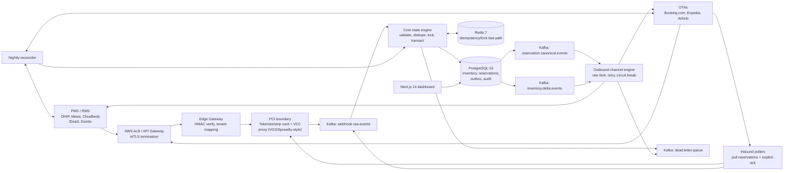

Production-oriented Hotel Channel Manager Architecture
1. Assumptions and scale
Request mix
“10,000 requests/min” is treated as 10,000 HTTP/API operations per minute across the platform, including partner callbacks, scheduled pulls, and dashboard reads. Kafka consumer work and outbound partner calls are additional internal operations. This mix is a sizing assumption to validate against traffic measurements.
Operation	Baseline share	Baseline rate	500 RPS burst mix
Inbound ARI updates	20%	33 RPS	100 RPS
Inbound reservation events	10%	17 RPS	50 RPS
Reservation polling requests	10%	17 RPS	50 RPS
Dashboard reads	60%	100 RPS	300 RPS
Total	100%	167 RPS	500 RPS

Baseline is rounded from 10,000/60 = 166.7 RPS. Polling rate counts poll requests, not the number of reservations returned. Poller concurrency and OTA quotas must be tuned per partner connection. ASSUMPTION – verify against partner docs for partner polling, reservation paging, and acknowledgment requirements.
Write and message estimates
Sizing model: each accepted ARI update or reservation event produces approximately 2 PostgreSQL writes (business state plus outbox/idempotency or processing state). A poll operation averages 1.5 returned reservations, each processed like an inbound reservation. Dashboard reads are read-only. Estimates exclude retries, audit detail rows, analytics, and outbound delivery-attempt records.
Measure	Baseline	500 RPS burst
Direct ARI and reservation writes/sec	~100	~300
Returned reservations from polls/sec (assumed)	~25	~75
Estimated PostgreSQL writes/sec	~250	~750
Kafka messages/sec	~125	~375

Kafka estimate counts one raw message per inbound ARI/reservation, one canonical message per accepted update, and one inventory delta for each accepted reservation. Poll requests themselves do not each create a message; returned reservations do. Averages assume one inventory delta per reservation. Actual fan-out can be higher for ARI updates that affect multiple room/date combinations. Burst figures apply the same mix to 500 RPS.
Dashboard reads should use tenant-scoped read paths and short-lived caching where appropriate. Avoid synchronous dashboard queries competing with reservation transactions on hot inventory rows.
Proposed SLOs
These are initial objectives, not guarantees; validate them through load tests and partner sandbox behavior.
- Gateway receipt: p99 <20 ms to validate request envelope/authentication, durably hand off to the raw-event path, and return 202. No synchronous business-state database transaction. A 202 is returned only after durable acceptance by the ingestion buffer/broker path; if raw payload tokenization or durable publication is unavailable, return a retryable failure instead of claiming acceptance.
- Reservation propagation: p99 <60 seconds from reservation receipt or poll acknowledgment to attempted availability propagation to other configured channels; p99 <5 minutes for partner channels with delayed or constrained APIs.
- Internal consistency: no internally caused oversell when inventory changes are accepted and serialized through the state engine and PostgreSQL transaction.
- Detection: detect and raise an operational alert for an external-channel conflict within 2 minutes of receiving evidence (webhook, poll, or reconciliation).
- Availability: propose 99.9% monthly availability for inbound acceptance and state processing, subject to AWS/partner dependencies and DR design.
External OTA sync latency means absolute prevention of external oversells is impossible. The system detects, contains, and escalates those conflicts.
2. Component architecture
mTLS terminates at the AWS ALB/API gateway. The Edge Gateway verifies partner HMAC signatures where configured, validates request bounds and tenant/connection mapping, and sends raw content through the PCI sanitization proxy before Kafka. Partner HMAC formats and signature headers are ASSUMPTION – verify against partner docs.
The proxy strips or tokenizes payment card and virtual credit card (VCC) data before any broker persistence. The broker must never receive unsanitized card/VCC data. The proxy is within the controlled PCI boundary; only the minimum required token/reference crosses into the channel manager. If sanitization fails, quarantine metadata only and reject/retry the request; do not publish the original payload.

Booking.com, Expedia (Partner Central/EQC APIs, not Rapid), and Airbnb connectivity APIs are partner-gated. Reservations are mostly pulled by polling with explicit acknowledgment. Exact endpoints, payloads, authentication, quotas, polling cursors, and acknowledgment semantics are ASSUMPTION – verify against partner docs for each contracted integration. Do not infer connectivity access from public consumer APIs.
Kafka topics and consumer groups
Topic	Purpose
webhook.raw.events	Sanitized raw partner payloads plus CloudEvents metadata and source references.
reservation.canonical.events	Normalized reservation lifecycle events emitted through the transactional outbox.
inventory.delta.events	Committed inventory-impact deltas for outbound propagation and projections.
dead.letter.queue	Poison messages and exhausted processing/delivery failures with reason and replay metadata.

Use property_id as the partition key for all property-scoped state events. This preserves per-property event order and keeps a property’s inventory operations on one partition. Start with 48 partitions per topic for a moderate multi-tenant deployment, scaling based on measured throughput, consumer parallelism, and partition skew. Kafka partition count is a capacity choice, not a guarantee against hot-property contention. Increasing partitions later can change key-to-partition mapping; perform repartitioning deliberately and preserve ordering during migration.
Consumer groups:
- core-state-engine: consumes raw events; instances parallelize across partitions, with one active consumer per assigned partition.
- outbound-channel-engine: consumes canonical reservation and inventory delta topics, separately scalable by partner adapter workload.
- analytics-projections: optional independent group for non-authoritative read models.
- dead-letter-operations: controlled inspection and replay workflow; never blindly replay poison events.
Use KafkaJS with idempotent processing at the application/database boundary. Kafka transactions alone do not atomically include PostgreSQL commits.
3. Concurrency design
The primary correctness mechanism is PostgreSQL row locking and transactional availability checks. For every requested room-type/date range, lock inventory rows in deterministic order, verify available quantity, apply the decrement, and write the reservation/outbox records in one transaction.
Kafka per-property partition ordering reduces concurrent work for the same property, but it is not sufficient as the sole correctness control: writes can arrive from distinct paths, replays, pollers, manual operations, or future consumers. PostgreSQL is the source of truth and enforces the final serialization point.
Redis locks are not required for correctness and are not needed for the initial design. Keep Redis as an optional contention-reducing optimization only if production metrics show repeated lock contention that materially harms latency. A Redis lease cannot replace database row locks because lease expiry, failover, or network partitions can allow overlapping workers. If enabled, the database transaction must still independently validate and serialize inventory updates.
Lock inventory rows by room_type_id, then date ascending for all multi-day operations. Use the same order in reservation, ARI, and reconciliation transactions. This reduces deadlocks; deadlock retries with bounded jitter remain necessary.
If Redis locks are retained:
- Acquire a lease with a unique owner token and bounded TTL; release only if the owner token still matches.
- Include a monotonically increasing fencing token from a durable source and require downstream guarded writes to reject stale tokens. Redis INCR alone is not a safe fencing source across data loss/failover; use a durable monotonic allocator or omit Redis locking.
- Set PostgreSQL lock_timeout and statement_timeout shorter than the Redis lease TTL, with enough margin to abort and release before lease expiry. Example: DB lock timeout 1 s, statement timeout 3 s, lease TTL 10 s; choose values from measured transaction time and network conditions.
- On Redis outage, bypass the optimization and rely on PostgreSQL locks, or shed/retry if observed contention makes that unsafe operationally. Correctness must not depend on Redis availability.
4. Reservation lifecycle
Canonical lifecycle states: new, modified, cancelled, and no_show. Keep event action/state distinct from operational conflict status (OVERSOLD).
- New: deduplicate by stable partner identity/version key, then attempt inventory decrement transactionally.
- Modified: compare source version/sequence and apply only if newer. If the partner lacks a reliable version, use partner update timestamp plus deterministic tie-break metadata as an explicitly weaker fallback.
- Cancelled: restore inventory once, guarded by the reservation’s current state/version and cancellation idempotency.
- No-show: record operational status; inventory release/retention is a tenant-configurable policy and must not be assumed to match every partner contract.
- Out of order: persist receipt for audit, mark stale/ignored if its source version is older than the latest applied version, and do not reverse newer state.
When an OTA has already confirmed a booking that exceeds our available inventory, accept the booking, flag it OVERSOLD, alert operations, auto-close affected inventory on other channels, and push a conflict item to the conflict queue for resolution. Do not reject or silently discard the confirmed guest. A PostgreSQL CHECK constraint may guard our own inventory decrement logic; it cannot prevent an OTA from confirming against stale external availability.
Transactional outbox and idempotency
Within one PostgreSQL transaction: claim the idempotency key, lock inventory rows, update reservation/inventory state, and insert outbox events. A separate publisher reads committed outbox rows and publishes to Kafka, marking publication progress. Publication may repeat after a crash, so consumers must remain idempotent.
The PostgreSQL unique constraint/index on (channel_connection_id, res_id, version) (or an equivalent stored key) is the authority. Redis SETNX can be a fast-path cache only; its loss or expiry must not change correctness.
Logical idempotency key: sha256(channel_connection_id + res_id + version). Normalize and delimit the components before hashing to avoid ambiguous concatenations. Never hash credentials or include secrets in the key.
5. Failure-mode table
Failure	Detection	Behavior	Recovery
Redis down mid-transaction	Redis errors, connection health, operation metrics	Continue with PostgreSQL locks; skip cache/optimization. Redis is not transaction authority.	Restore Redis; rebuild cache lazily. Investigate contention if DB load rises.
PostgreSQL failover	Driver connection errors, health checks, replication/failover telemetry	Abort in-flight DB transactions; do not acknowledge durable processing. Gateway returns retryable failure if durable raw acceptance is unavailable.	Reconnect with bounded backoff; replay uncommitted raw events. Verify replica promotion and outbox continuity.
Kafka broker loss	Producer errors, ISR/under-replicated partition alerts	Do not return 202 unless broker durability policy or another durable raw buffer accepted the message. Pause consumers as needed.	Kafka replication/failover; retry with backoff and idempotency.
Consumer crash after DB commit before offset commit	Consumer restart sees same offset/event; duplicate metric	Redeliver event; PostgreSQL unique key and state transition make processing idempotent.	Reprocess, then commit offset. Alert on repeated crash loop.
OTA 429/5xx	Adapter response classification, retry and queue-age metrics	Respect verified partner limits; exponential backoff with jitter, circuit breaker, per-connection throttling.	Retry within bounded window; escalate aged inventory/reservation work. Partner limits are ASSUMPTION – verify against partner docs.
Poison message	Schema/validation failure, retry count threshold	Stop repeated hot-loop; send sanitized event and error metadata to dead.letter.queue; do not lose source reference.	Fix mapping or data issue; operator-approved replay with original ordering considerations.
Duplicate delivery	Unique-key conflict, duplicate counters	Treat as already applied; do not double decrement or acknowledge twice.	Commit offset/ack after authoritative duplicate check.
Clock/timezone mismatch	Offset/timestamp anomalies, date-boundary reconciliation	Store property-local business date separately from UTC event/receipt times; reject ambiguous date conversion into quarantine.	Correct property timezone/config, recompute affected inventory, audit changes.
PMS push failure (saga/compensation)	Delivery attempts, adapter errors, reconciliation drift	Keep accepted reservation authoritative; mark PMS sync pending. Retry idempotently. Do not automatically “undo” a guest-confirmed reservation.	Saga retries and reconciliation; compensate only a reversible downstream side effect, with audit and ops approval for booking changes.
Outbox publisher crash after publish before marking sent	Outbox age and duplicate downstream event metrics	Event may be republished. Consumers dedupe by event id and aggregate key/version.	Resume publisher; duplicates are harmless by design.
Property hot partition	Per-partition lag and key skew	Preserve property order; isolate expensive outbound fan-out from core transaction group.	Increase consumers/partitions for other keys; optimize hot-property batching and database access.

6. Enterprise concerns
- Multi-tenancy: tenant ID is mandatory in every business row, event, and query context. Enforce PostgreSQL row-level security (RLS) as defense in depth; use tenant-scoped application roles or carefully controlled session context. Apply per-tenant and per-connection rate limits at gateway and outbound scheduler.
- RBAC/SSO: federate enterprise identity through OIDC/SAML; map roles to tenant/property scopes. Require least privilege for reservation PII and conflict resolution. Audit privileged access.
- Secrets and token rotation: store partner OAuth credentials and signing secrets in AWS Secrets Manager, protected by KMS. Rotate with overlap windows where supported; never log secrets. OAuth grants, refresh behavior, and partner rotation support are ASSUMPTION – verify against partner docs.
- GDPR, residency, and retention: minimize PII in canonical events; keep payment data outside the broker and channel manager boundary. Define tenant region placement and retention/deletion schedules, including Kafka retention, outbox, audit, and backups. Legal basis and residency requirements depend on customer jurisdictions and contracts.
- Audit trail: immutable actor/action/time/source/version records for reservation changes, inventory changes, access, overrides, and conflict resolution. Avoid storing raw card data or unnecessary payload copies.
- Observability: OpenTelemetry traces, metrics, and structured logs with correlation/event IDs. Track webhook acceptance latency, poll age, consumer lag, outbox age, lock wait, reservation-to-propagation latency, OTA errors/rate limits, and oversell/conflict count.
- DR and availability: deploy across multiple AZs. Initial targets: RPO ≤5 minutes for regional disaster recovery and RTO ≤60 minutes, with stricter intra-region failover objectives. These require tested PostgreSQL backup/replication, Kafka replication/restore procedures, secrets recovery, and documented regional partner connectivity constraints.
- Data residency and DR tension: cross-region replication must follow tenant residency commitments; define tenant-level regional placement before enabling cross-region copies.
7. Contracts
CloudEvents types
Use CloudEvents 1.0 envelopes with specversion, id, source, type, subject, time, datacontenttype, and data; include tenant/property/connection context in data or approved extension attributes.
Core event types:
- com.hospitality.ari.delta
- com.hospitality.reservation.created
- com.hospitality.reservation.modified
- com.hospitality.reservation.cancelled
- com.hospitality.reservation.no_show
- com.hospitality.reservation.oversold
- com.hospitality.inventory.propagation.requested
- com.hospitality.inventory.propagation.failed
Zod canonical payload schemas
import { z } from "zod";

const IsoDate = z.string().regex(/^\d{4}-\d{2}-\d{2}$/);
const UtcDateTime = z.string().datetime({ offset: true });

export const ReservationSchema = z.object({
  tenantId: z.string().min(1),
  propertyId: z.string().min(1),
  channelConnectionId: z.string().min(1),
  channel: z.enum(["booking_com", "expedia", "airbnb", "pms", "other"]),
  reservationId: z.string().min(1),
  version: z.string().min(1),
  lifecycle: z.enum(["new", "modified", "cancelled", "no_show"]),
  status: z.enum(["confirmed", "cancelled", "no_show"]),
  roomTypeId: z.string().min(1),
  ratePlanId: z.string().optional(),
  stay: z.object({
    checkIn: IsoDate,
    checkOut: IsoDate,
    propertyTimeZone: z.string().min(1),
  }),
  occupancy: z.object({
    adults: z.number().int().nonnegative(),
    children: z.number().int().nonnegative().default(0),
  }),
  guest: z.object({
    givenName: z.string().optional(),
    familyName: z.string().optional(),
    email: z.string().email().optional(),
    phone: z.string().optional(),
  }).optional(),
  paymentReference: z.string().optional(),
  currency: z.string().length(3).optional(),
  totalAmount: z.number().nonnegative().optional(),
  sourceUpdatedAt: UtcDateTime.optional(),
  receivedAt: UtcDateTime,
  oversold: z.boolean().default(false),
}).strict().superRefine((value, ctx) => {
  if (value.stay.checkOut <= value.stay.checkIn) {
    ctx.addIssue({
      code: z.ZodIssueCode.custom,
      path: ["stay", "checkOut"],
      message: "checkOut must be after checkIn",
    });
  }
});

export const AriDeltaSchema = z.object({
  tenantId: z.string().min(1),
  propertyId: z.string().min(1),
  channelConnectionId: z.string().min(1),
  source: z.enum(["pms", "rms", "channel_manager", "ota"]),
  roomTypeId: z.string().min(1),
  ratePlanId: z.string().optional(),
  stay: z.object({
    startDate: IsoDate,
    endDate: IsoDate,
    propertyTimeZone: z.string().min(1),
  }),
  availability: z.number().int().nonnegative().optional(),
  closed: z.boolean().optional(),
  restrictions: z.object({
    minStay: z.number().int().positive().optional(),
    maxStay: z.number().int().positive().optional(),
    closedToArrival: z.boolean().optional(),
    closedToDeparture: z.boolean().optional(),
  }).optional(),
  currency: z.string().length(3).optional(),
  nightlyRates: z.array(z.object({
    date: IsoDate,
    amount: z.number().nonnegative(),
  }).strict()).optional(),
  sourceVersion: z.string().min(1),
  sourceUpdatedAt: UtcDateTime.optional(),
  receivedAt: UtcDateTime,
}).strict().superRefine((value, ctx) => {
  if (value.stay.endDate <= value.stay.startDate) {
    ctx.addIssue({
      code: z.ZodIssueCode.custom,
      path: ["stay", "endDate"],
      message: "endDate must be after startDate",
    });
  }
});
These are canonical starting contracts, not partner wire schemas. Map OTA/PMS payloads in isolated adapters; unknown fields and semantics require partner documentation and contract tests.
AsyncAPI outline
asyncapi: 2.6.0
info:
  title: Hotel Channel Manager Events
  version: 1.0.0
defaultContentType: application/cloudevents+json
servers:
  production:
    url: kafka:9092
    protocol: kafka
channels:
  webhook.raw.events:
    description: Sanitized raw partner payloads; card/VCC data must be removed before publish.
    publish:
      message:
        name: SanitizedWebhookReceived
        payload:
          $ref: '#/components/schemas/CloudEvent'
  reservation.canonical.events:
    description: Canonical reservation lifecycle events from the transactional outbox.
    publish:
      message:
        name: ReservationCanonicalEvent
        payload:
          $ref: '#/components/schemas/CloudEvent'
  inventory.delta.events:
    description: Committed inventory and restriction changes for propagation.
    publish:
      message:
        name: InventoryDeltaEvent
        payload:
          $ref: '#/components/schemas/CloudEvent'
  dead.letter.queue:
    description: Exhausted or invalid messages with sanitized error metadata and replay references.
    publish:
      message:
        name: DeadLetterEvent
        payload:
          $ref: '#/components/schemas/CloudEvent'
components:
  schemas:
    CloudEvent:
      type: object
      required: [specversion, id, source, type, time, data]
      properties:
        specversion:
          type: string
          const: "1.0"
        id:
          type: string
        source:
          type: string
        type:
          type: string
        subject:
          type: string
        time:
          type: string
          format: date-time
        datacontenttype:
          type: string
        data:
          type: object
      description: Kafka message key is property_id for property-scoped events.
8. Directory structure
/ingestion-gateway       Fastify edge handlers, HMAC verification, tenant mapping, PCI-proxy client.
/core-state-engine       Reservation and inventory state transitions, PostgreSQL transactions, outbox publisher.
/hospitality-contracts   Zod canonical schemas, CloudEvents types, AsyncAPI contract.
/adapters                Partner-specific PMS, RMS, OTA mappings, polling, acknowledgment, and delivery.
/testing-dashboard       Next.js 14 + Tailwind developer and operations dashboard.
/infra                   Docker and Kubernetes deployment configuration and operational manifests.
/tests                   Contract, integration, concurrency, replay, and partner-sandbox test suites.
KNOWN GAPS
- Partner access, API contracts, auth, quotas, polling cadence, and acknowledgment behavior must be verified against each contracted partner’s current documentation and sandbox.
- Traffic mix, reservation-per-poll average, ARI fan-out, hot-property skew, and retention assumptions need production measurements and load testing.
- Canonical model requires mapping review against specific HTNG/OpenTravel Alliance message profiles used by each integration.
- PCI scope, tokenization design, residency, retention, and compliance controls require security and legal review.
- DR objectives require region selection and tested recovery exercises; partner integrations may constrain regional failover.
- This brief intentionally contains architecture and contracts only. DDL and application code are out of scope for this request.
HANDOFF SUMMARY
- Decision: production-oriented; Node.js 20/TypeScript strict, Fastify, PostgreSQL 16 with Kysely or pg, Redis 7/ioredis, Kafka/kafkajs, Zod, CloudEvents 1.0, Next.js 14/Tailwind, Docker/Kubernetes/AWS.
- Assumption: 10k req/min mix = 20% ARI, 10% inbound reservations, 10% polls, 60% dashboard; burst mix scales to 500 RPS.
- Estimates: baseline ~250 DB writes/sec and ~125 Kafka msgs/sec; burst ~750 DB writes/sec and ~375 Kafka msgs/sec.
- SLOs: gateway p99 <20 ms with 202 only after durable acceptance; reservation-to-propagation p99 <60 sec target; external oversells detected and mitigated, not absolutely prevented.
- Security: mTLS ends at ALB/API gateway; sanitize/tokenize card/VCC data inside PCI boundary before Kafka.
- Kafka topics: webhook.raw.events, reservation.canonical.events, inventory.delta.events, dead.letter.queue; key by property_id; initial 48 partitions/topic.
- Concurrency: Kafka ordering helps; PostgreSQL row locks are authority; Redis lock not needed for correctness. Lock by room_type_id, then date.
- Reservation policy: accept already-confirmed OTA bookings; mark OVERSOLD, alert ops, close other channels, enqueue conflict.
- Persistence concepts/table names: reservations, inventory, outbox, audit; PostgreSQL unique idempotency authority on (channel_connection_id, res_id, version).
- Idempotency key: SHA-256 of normalized channel_connection_id + res_id + version; Redis SETNX is cache only.
- CloudEvents types: com.hospitality.ari.delta, com.hospitality.reservation.created, .modified, .cancelled, .no_show, .oversold, com.hospitality.inventory.propagation.requested, .failed.
- Contract schemas: ReservationSchema, AriDeltaSchema; AsyncAPI covers all four Kafka topics.
- Directory paths: /ingestion-gateway, /core-state-engine, /hospitality-contracts, /adapters, /testing-dashboard, /infra, /tests.
- External integration caveat: Booking.com, Expedia Partner Central/EQC (not Rapid), and Airbnb connectivity are partner-gated; reservations mostly pulled with explicit acknowledgment; verify all partner details.
- Known gaps: partner docs/sandbox verification, workload measurement, OTA mapping review, PCI/legal review, and DR validation.